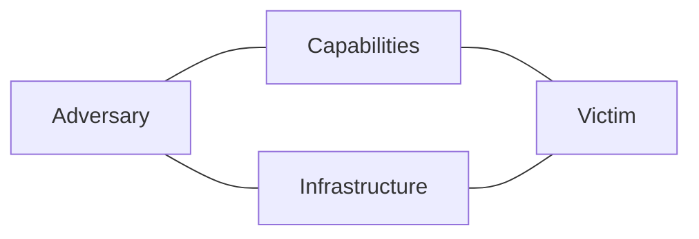

# Diamond Model

The Diamond Model is a framework for describing a cyber intrusion by analysing four connected features of an adversary event.

## The Four Features

| Feature | Description |
|---|---|
| Adversary | The person or group responsible for the activity |
| Infrastructure | Physical or logical resources used to conduct the activity |
| Capability | The tools, malware, or methods used by the adversary |
| Victim | The target of the activity |

## Adversary

The adversary is the actor behind the event.

- An adversary may be an individual, criminal group, hacktivist group, or state-sponsored team.
- The adversary is not always identifiable from infrastructure alone.
- Analyst knowledge and confidence should be recorded rather than assumed.

## Infrastructure

Infrastructure is the set of resources used to conduct an intrusion.

Examples include:

- Domains
- IP addresses
- Email accounts
- C2 servers
- Compromised websites
- Exposed cloud resources

## Capability

Capability describes what the adversary can do and the tools or techniques used.

Examples include:

- Malware
- Exploits
- Phishing kits
- Custom scripts
- Document macros

## Victim

The victim is the organisation or system targeted by the activity.

Victim information can include:

- Organisation and industry
- Geographic location
- Systems and assets
- Employee roles
- Data and services affected

## Meta-Features

The core features can be enriched with meta-features, depending on available evidence:

- **Timestamp:** When the event occurred
- **Phase:** Which part of the attack lifecycle applies
- **Result:** Success or failure of the activity
- **Direction:** The direction of the interaction
- **Methodology:** The broader technique or approach
- **Resources:** Resources required or used

## Analytic Pivoting

Analysts can pivot from one diamond feature to discover related evidence.

Examples:

- A malicious domain can lead to associated IP addresses.
- A malware hash can lead to other samples or victims.
- A victim pattern can reveal targeting by a known adversary.
- Infrastructure reuse can link separate incidents.

## SOC Value

The Diamond Model helps SOC analysts:

- Structure incident data
- Link related intrusion events
- Identify evidence gaps
- Communicate findings clearly
- Pivot investigations across victims and infrastructure
- Build stronger threat intelligence

## Relation to the Cyber Kill Chain

The Cyber Kill Chain explains the stages of an attack. The Diamond Model describes the relationships between adversary, infrastructure, capability, and victim at each event.

Both models complement one another:

- Cyber Kill Chain: **What stage is occurring?**
- Diamond Model: **Who is involved, using what, against whom, and through what infrastructure?**
