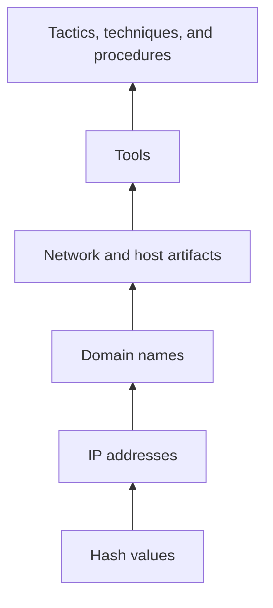

# Pyramid of Pain

The Pyramid of Pain is a model that shows how much difficulty an adversary faces when defenders detect or block different types of indicators.

Higher levels are generally harder for an adversary to change and therefore cause more pain.

## Levels

| Level | Indicator or behaviour | Defensive use | Difficulty for attacker |
|---|---|---|---|
| Hash values | Unique file fingerprints | Block or identify known malicious files | Trivial |
| IP addresses | Source or destination addresses | Block or investigate network activity | Easy |
| Domain names | Malicious or suspicious domains | Filter DNS and web traffic | Simple |
| Network and host artifacts | URLs, registry changes, file paths, processes, and network patterns | Detect activity through endpoint and network telemetry | Annoying |
| Tools | Malware, utilities, and exploitation frameworks | Detect and remove attacker tools | Challenging |
| TTPs | Adversary tactics and techniques | Detect behaviours independent of indicators | Tough |

## Hash Values

Hash values identify the exact contents of a file.

- Common hashes include MD5, SHA-1, and SHA-256.
- Attackers can change a file slightly to produce a different hash.
- Hash blocking is useful but should not be the only defensive control.

## IP Addresses

An IP address can identify infrastructure used for malicious activity.

- IP addresses may be shared, temporary, or reassigned.
- Blocking a single address can be bypassed by infrastructure changes.
- Network context and reputation should be considered.

## Domain Names

Domains provide a more flexible way to identify malicious infrastructure.

- Attackers may register new domains or use compromised domains.
- Domain-based detections can disrupt C2 and phishing activity.
- DNS and web proxy logs are useful sources for investigation.

## Network and Host Artifacts

Artifacts are observable traces left on hosts or in network traffic.

Examples include:

- Malicious URLs
- Suspicious User-Agent strings
- Registry changes
- Created or modified files
- Processes and command lines
- Abnormal network connections

## Tools

Defenders can focus on detecting attacker tools and their use.

Examples include:

- Remote access tools
- Malware loaders
- Credential dumping tools
- Network scanners
- Exploitation frameworks

Detecting tools can be harder than blocking a single indicator because tools may be legitimate software used maliciously.

## Tactics, Techniques, and Procedures

TTPs describe how an adversary operates.

- **Tactics:** The adversary's goal at a stage.
- **Techniques:** The general method used to achieve a goal.
- **Procedures:** Specific implementations used by an adversary.

MITRE ATT&CK is commonly used to map and detect TTPs.

Defending at this level means detecting behaviour instead of relying only on hashes or domains. This usually creates the most disruption for an adversary.

## SOC Applications

SOC analysts can use the Pyramid of Pain to:

- Choose detections that are more difficult for attackers to evade
- Improve threat hunting
- Add context to alerts and incident reports
- Prioritize detections at the artifact, tool, and TTP levels
- Create layered defenses instead of relying on one indicator

## Further Reading

- [MITRE ATT&CK](https://attack.mitre.org/)
- [CISA Cybersecurity Resources](https://www.cisa.gov/topics/cybersecurity-best-practices)
